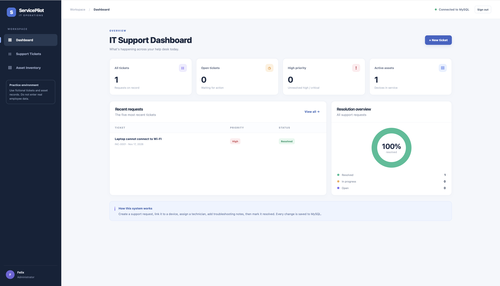
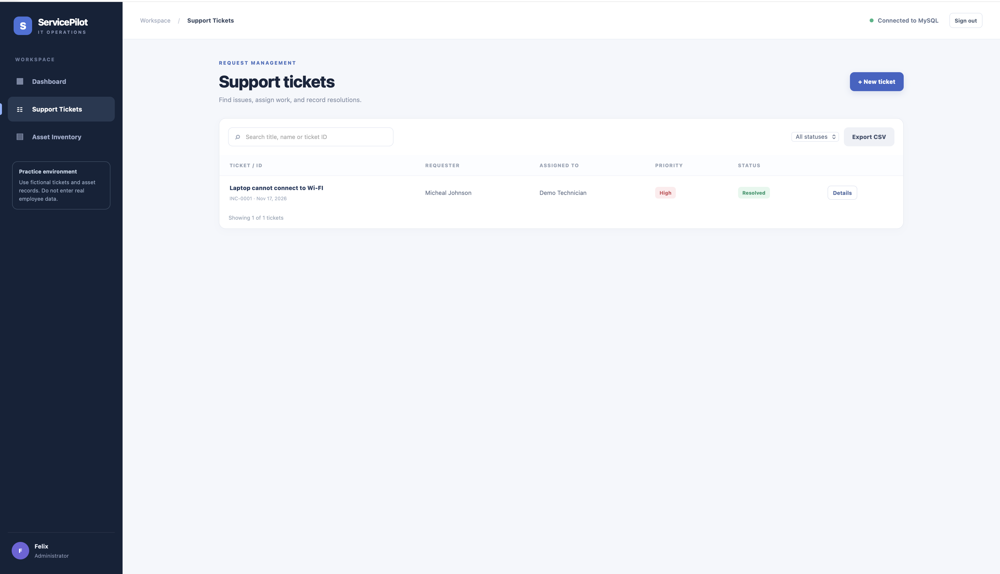
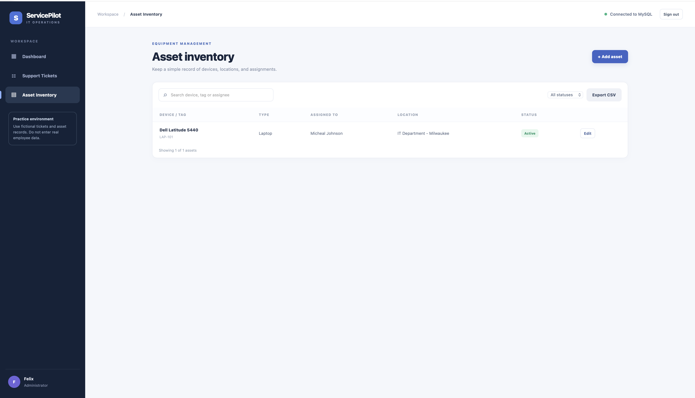

# ServicePilot — IT Help Desk & Asset Management

A small IT support workspace built with **HTML, CSS, vanilla JavaScript, Node.js, Express, and MySQL**. Staff can open help desk tickets, update assignments and statuses, document troubleshooting, and track equipment.

This is a **portfolio / learning project**, not a production IT service desk. All people, incidents and serial numbers in the sample dataset are fictional. It should not be deployed for real employee data without a fuller security and privacy review.

## Application Screenshots

### IT Support Dashboard


### Support Ticket Management


### Asset Inventory


## What works

- Email/password sign-in, password hashes (scrypt), server-side sessions, sign-out
- Administrator and technician roles (only admins can create/edit assets)
- Dashboard counts for open, urgent, resolved, and active equipment
- Create tickets with requester, category, priority, description, linked asset
- Assign a technician, link/change an asset, update priority and ticket status
- Write troubleshooting notes and see timestamped ticket activity history
- Add/edit assets with tag, name, type, serial, location, user, and status
- Search and filter tickets/assets; download filtered results to CSV
- Responsive layout on desktop and phone; empty states and error messages

## Technology choices

| Layer | Technology | Reason |
|---|---|---|
| Interface | HTML, CSS, plain JavaScript | Easy to inspect and learn; no framework setup |
| Server | Express 5, Node.js 22+ | Routes HTTP requests and validates inputs |
| Database | MySQL | Stores users, sessions, tickets, assets, activity |
| Authentication | Node crypto scrypt + random session token | Passwords aren't stored as plaintext; cookies aren't readable by JavaScript |

## Setup (Mac / Windows / Linux)

1. Install **Node.js 22+**, **MySQL Server 8+**, and optionally **MySQL Workbench**. MySQL Workbench is a client, **not** the database server.
2. Open the `servicepilot-complete` folder in VS Code.
3. In MySQL Workbench, connect to your own running MySQL Server and open/run **`schema.sql`**. This creates a database named `servicepilot`. **Use a fresh database**: this schema is not a migration for the earlier starter project.
4. Copy `.env.example` to `.env`. Set `DB_USER` and `DB_PASSWORD` to your local MySQL credentials; change DB_HOST or DB_PORT if needed.
5. Open a terminal in this folder and run:

   ```bash
   npm install
   npm run create-user
   ```

   Make your first user an `admin`. Use a made-up email and strong password (12+ characters). The simple CLI prompts for the password in your terminal; avoid entering secrets on shared screens.
6. Optional but recommended: run **`seed.sql`** once, from MySQL Workbench, to load five fictional tickets and assets. (Run this **after** creating tables; user creation can occur before or after seeding.)
7. Start the server:

   ```bash
   npm start
   ```

8. Go to **http://localhost:3000**. Sign in with the user you just created. The app fetches live records from your local MySQL database.

### Common problems

- **Cannot connect to MySQL** — Make sure MySQL Server is running and the `.env` values match your MySQL account. MySQL Workbench alone is not enough.
- **Access denied** — Check `DB_USER`, `DB_PASSWORD`, and permissions for database `servicepilot`.
- **Unknown database / table** — Re-run `schema.sql` in a fresh database.
- **Session expired** — Sessions last eight hours. Sign back in.
- **Port already in use** — Change `PORT` in `.env` and open the matching address.
- **Server on, but no records** — Seed data is optional; create a ticket and asset through the UI.
- **Password visible during account setup** — This is a local setup CLI. Don't screen-share while entering it.

## Demonstration scenario (good for a portfolio walkthrough)

1. Create a laptop asset `LAP-110` assigned to a fictional employee.
2. Open a new **Network** ticket: "Laptop can't connect to Wi-Fi".
3. Link the new ticket to `LAP-110`.
4. Assign a technician and change the status to **In Progress**.
5. Add an activity note: "Reset network adapter and confirmed connection".
6. Mark **Resolved**. Confirm the dashboard counts update.
7. Filter the ticket list to **Resolved**, then export CSV.

## Testing

```bash
npm run check
npm test
```

These run JavaScript syntax checks and unit tests for validation, password hashing and session helpers. **Database/API integration must also be verified on a computer with MySQL**. Use `docs/test-checklist.md` for manual end-to-end tests. Do not describe this project as production-secure or fully deployed based only on these tests.

## File map

```
public/index.html         screens and forms
public/styles.css         layout, typography and responsive styles
public/app.js             API calls, filters, dialogs and rendering
server.js                 Express endpoints and business rules
lib/validation.js         shared backend input validation
lib/security.js           password hashing and session tokens
schema.sql                MySQL tables, keys, foreign keys
seed.sql                  fictional sample data
scripts/create-user.js    local account setup
tests/                   small unit test suite
docs/                    design decisions and test checklist
```

## Feature boundaries and security notes

- Intended for **local demonstration**. There is no password reset, self-service signup, email notification, audit exports, file attachment feature, or multi-tenant access separation.
- Do not publish `.env`, real passwords, personal email lists, corporate inventory, or real tickets.
- Session tokens are random, hashed in the database, in HttpOnly SameSite cookies; `Secure` cookies are enabled in `NODE_ENV=production`. Production hosting still requires **HTTPS**, safe reverse-proxy configuration, backups, strong secrets and permissions, rate limiting, monitoring, and security testing.
- The login throttle is per-process memory. It is **not sufficient for a public multi-server deployment**. Cross-site modifications use a custom header, origin checks, and SameSite cookies; a public deployment deserves a fuller security review.
- Only admins can change asset inventory; both admins and technicians can manage the shared ticket queue. This models a **small internal IT team**, not external customers.
- The basic API lists up to 500 records and the page filters them locally. Large real organizations need server-side pagination, indexing strategy, and search.

## Suggested portfolio writeup

Explain **what the application does**, **why the database has foreign keys**, **how the ticket lifecycle works**, **how you tested it**, **what problems you encountered**, and **what you'd improve next**. Include your own screenshots of tested features and link to the real repository. Be accurate about your contributions and any tools used during development.